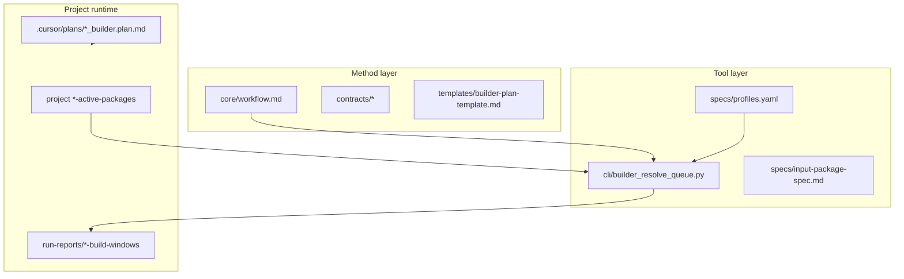

# MANIFEST — Zeya888 Builder Queue

## Что это

**Zeya888 Builder Queue** — методология вайб-кодинга с жёстким контрактом между оператором и AI-агентом:

- **Requirement / Epic / Story** → декомпозиция в task tree
- **Immutable package** (`pkg-*.yaml`) — машиночитаемая очередь
- **Build window** — производный срез для одной сессии Cursor
- **Phases P0–P8** — onboarding, plan, execute, audit, gap scaffold, commits

## Три слоя SSOT

| Слой | Где править | Когда |
|------|-------------|-------|
| **Method** | `core/`, `contracts/`, `templates/`, `prompts/` | Изменение процесса, промптов, правил |
| **Tool** | `cli/`, `specs/profiles.yaml` | Новый проект, пути, CLI |
| **Runtime** | `.cursor/plans/`, `pkg-*.yaml` в проекте | Операционная работа, текущий pkg |

## Карта файлов

| Файл | Роль |
|------|------|
| [`core/session-starter.md`](./core/session-starter.md) | Phase 0 onboarding, OPERATOR CONFIG |
| [`core/workflow.md`](./core/workflow.md) | Короткие промпты **PA**, P1–P8 |
| [`core/workflow-legacy.md`](./core/workflow-legacy.md) | Полные self-contained промпты |
| [`prompts/INDEX.md`](./prompts/INDEX.md) | Индекс useful prompts (architect / operator / migration / **training** / housekeeping) |
| [`prompts/training/INDEX.md`](./prompts/training/INDEX.md) | Training dialogues 01–04A/B (teaching; not operative) |
| [`curriculum/human-entry-manual.md`](./curriculum/human-entry-manual.md) | Human first entry: routes, chats, prompts |
| [`guides/consultation-positioning.md`](./guides/consultation-positioning.md) | Self-serve vs guided adoption; fintech ceiling |
| [`curriculum/00-guide-for-humans.md`](./curriculum/00-guide-for-humans.md) | Meaning wrapper for humans (legacy RU body may remain) |
| [`prompts/architect/cross-project-system-orientation.md`](./prompts/architect/cross-project-system-orientation.md) | Pre-PA: карта 4 проектов + cross-project docs → story candidates |
| [`prompts/architect/cross-project-requirements-backlog-bootstrap.md`](./prompts/architect/cross-project-requirements-backlog-bootstrap.md) | Pre-PA session lock: parent REQs из `docs/requirements backlog/` across gateway/identity/spa/gpt |
| [`prompts/architect/parent-requirement-to-project-reqs.md`](./prompts/architect/parent-requirement-to-project-reqs.md) | Pre-PA.2: parent product REQ → per-project child REQs + связи |
| [`prompts/architect/cross-project-req-scatter.md`](./prompts/architect/cross-project-req-scatter.md) | Pre-PA.2 write-after-impact: parent → `{project}/docs/requirements/` children (gateway/identity/spa/gpt) |
| [`prompts/architect/cross-project-req-consistency-audit.md`](./prompts/architect/cross-project-req-consistency-audit.md) | Findings-only: parent+child REQ consistency + target-state audit → `docs/analysis/` |
| [`prompts/architect/req-to-target-tech-architecture.md`](./prompts/architect/req-to-target-tech-architecture.md) | REQ → target tech architecture of focus (+ interview); packaging is a theme pack |
| [`prompts/architect/req-to-backlog-stories.md`](./prompts/architect/req-to-backlog-stories.md) | Post-REQ: non-UI → backlog STORY package (plan → materialize) |
| [`prompts/architect/req-to-ui-admin-layers.md`](./prompts/architect/req-to-ui-admin-layers.md) | Post-REQ: UI → ADMIN-01…06 layer package (plan → materialize) |
| [`prompts/architect/req-to-frontend-mixed-package.md`](./prompts/architect/req-to-frontend-mixed-package.md) | Post-REQ: FE mixed → classify ui_first/tech_first; ADMIN projected + STORY (plan → materialize) |
| [`prompts/operator/operator-root-start.md`](./prompts/operator/operator-root-start.md) | Root OP bootstrap: project only → session bind |
| [`prompts/operator/operator-root-wave.md`](./prompts/operator/operator-root-wave.md) | Root OP: stories → wave plan + handoff packets (BLD/VAL) |
| [`prompts/operator/operator-root-subagent-run.md`](./prompts/operator/operator-root-subagent-run.md) | Root OP Phase B: profile + queueSpec → OP-*.plan.md + two subagents overnight |
| [`prompts/operator/lightweight-followup-triage.md`](./prompts/operator/lightweight-followup-triage.md) | VAL complexity gate for lightweight follow-up |
| [`prompts/operator/lightweight-followup-author.md`](./prompts/operator/lightweight-followup-author.md) | Dual plans + LAUNCH after triage PASS |
| [`prompts/migration/migration-zeya888-brand-landing-infra-transfer.md`](./prompts/migration/migration-zeya888-brand-landing-infra-transfer.md) | `zeya888-brand`: landing infra → `zeya888` (1A, no NC) |
| [`prompts/migration/migration-profile-from-checked-out-dir.md`](./prompts/migration/migration-profile-from-checked-out-dir.md) | Checked-out dir → inspect → intake → materialize profile |
| [`guides/operator-root-orchestrator.md`](./guides/operator-root-orchestrator.md) | Процесс root→субагенты + roadmap MVP/Task/SDK |
| [`guides/orchestrator-builder-reference.md`](./guides/orchestrator-builder-reference.md) | Proven overnight two-subagent SSOT (universal) |
| [`guides/operator-how-to-run-queue.md`](./guides/operator-how-to-run-queue.md) | Human how-to: запуск очереди стори/багов в OP |
| [`examples/reference-plans/Orchestrator_Builder_Reference.plan.md`](./examples/reference-plans/Orchestrator_Builder_Reference.plan.md) | Teaching snapshot: OP overnight two-subagent эталон |
| [`cli/queue-manual.md`](./cli/queue-manual.md) | Справочник CLI |
| [`specs/input-package-spec.md`](./specs/input-package-spec.md) | Контракт YAML пакета |
| [`specs/profiles.yaml`](./specs/profiles.yaml) | Реестр проектов |
| [`specs/profile-intakes/`](./specs/profile-intakes/) | Pending intake YAML (alias + path) → bootstrap нового профиля |
| [`examples/reference-plans/`](./examples/reference-plans/) | Teaching snapshots — не runtime SSOT (`*_builder` + Orchestrator_Builder_Reference) |
| [`guides/spa-ui-visual-pipeline.md`](./guides/spa-ui-visual-pipeline.md) | Spa UI Visual Pipeline — полный SSOT UI-0..UI-3 (visual/mixed tasks) |
| [`guides/builder-artifact-dates.md`](./guides/builder-artifact-dates.md) | Дисциплина дат pkg / gate / run-summary; `--print-utc-now`, `--check-dates` |
| [`guides/fixed-builder-plan-execution.md`](./guides/fixed-builder-plan-execution.md) | Fixed `*_builder.plan.md`: @attach, не Build; отвязка от чужого чата Cursor |
| [`guides/lightweight-followup.md`](./guides/lightweight-followup.md) | Low-complexity follow-up after Done stories: triage + dual plans + VAL↔BLD |
| [`templates/story-acceptance-gate-template.md`](./templates/story-acceptance-gate-template.md) | Шаблон story gate с Date discipline |
| [`curriculum/06-architect-studio-and-p1-intakes.md`](./curriculum/06-architect-studio-and-p1-intakes.md) | Studio = PA chat; gap; три P1 intakes |
| [`curriculum/learning-path.md`](./curriculum/learning-path.md) | Routes A/B + modules 0–6 (Human + Operative) |
| [`contracts/scripts-operator-contract.md`](./contracts/scripts-operator-contract.md) | Operator contract для `builder_project: scripts` (tooling) |
| [`contracts/capybara-operator-contract.md`](./contracts/capybara-operator-contract.md) | Operator contract для `builder_project: capybara` (Vue+Node + CLI) |
| [`contracts/landing-operator-contract.md`](./contracts/landing-operator-contract.md) | Operator contract для `builder_project: landing` (Astro+TS+Tailwind) |
| [`contracts/zeya888-operator-contract.md`](./contracts/zeya888-operator-contract.md) | Operator contract для `builder_project: zeya888` (WordPress/PHP, focus `zeya888.me`) |
| [`contracts/arweave-operator-contract.md`](./contracts/arweave-operator-contract.md) | Operator contract для `builder_project: arweave` (Node.js Arweave sidecar) |
| [`contracts/dogestonia-operator-contract.md`](./contracts/dogestonia-operator-contract.md) | Operator contract для `builder_project: dogestonia` (React Native/Expo app) |
| [`contracts/aibridge-operator-contract.md`](./contracts/aibridge-operator-contract.md) | Operator contract для `builder_project: aibridge` (Python Responses bridge) |
| [`contracts/zeya888-brand-operator-contract.md`](./contracts/zeya888-brand-operator-contract.md) | Operator contract для `builder_project: zeya888-brand` (focus `zeya888/`, не `zeya888.me`) |
| [`contracts/threads-operator-contract.md`](./contracts/threads-operator-contract.md) | Operator contract для `builder_project: threads` (focus `doge-threads/`) |
| [`guides/add-builder-profile.md`](./guides/add-builder-profile.md) | SSOT bootstrap нового профиля + Gateway clone |
| [`guides/from-cross-project-req-to-story-packages.md`](./guides/from-cross-project-req-to-story-packages.md) | EN: parent REQ → child REQ → tech arch → STORY/ADMIN (architect sequence) |

## Исторические пути

Артеfactы до миграции (build-windows, story gates, run-summaries) могут ссылаться на `docs/methodology/builder-queue/`. Это **исторический контекст**; операционные команды — только `Zeya888-builder-queue/cli/`.

## Propagation checklist

При изменении методологии обновить:

1. `core/workflow.md` (если меняются PA/P* промпты)
2. `prompts/` + `prompts/INDEX.md` (если меняется useful prompt вне PA/P*)
3. `.cursor/skills/builder-session/SKILL.md`
4. `.cursor/rules/builder-operator-habits.mdc`
5. Соответствующий `contracts/*-operator-contract.md`
6. `CHANGELOG.md` + bump `VERSION`

**Не** править `examples/reference-plans/` для runtime — только при обновлении учебного снимка.
