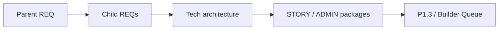

# From cross-project REQ to story packages (Architect Studio)

Human-language guide for operators. Full prompt text lives under [`../prompts/architect/`](../prompts/architect/). This page explains **what order to run** and **which prompt to pick** — not a substitute for the fences.

**Method:** [`.cursor/rules/analysis.mdc`](../../../../.cursor/rules/analysis.mdc)  
**Catalog:** [`../prompts/INDEX.md`](../prompts/INDEX.md) §architect/

---

## 1. What you are doing

You turn one **parent** product requirement into **implementable work packages** per Builder Queue profile — without skipping levels or inventing APIs.

**Two parent homes:**

| Track | Parent lives | Profiles |
|-------|--------------|----------|
| **DOGE classic-four** | often `docs/requirements backlog/` | `gateway`, `identity`, `spa`, `gpt` |
| **Client tenancy** | `clients/<Client>/docs/requirements/` | keys from [`../specs/clients.yaml`](../specs/clients.yaml) (Alvasar: `alvasar-backend`, `alvasar-ui`) — see [`client-tenancy.md`](./client-tenancy.md) |

| Level | What it is | Typical output |
|-------|------------|----------------|
| Parent product REQ | Cross-project / multi-MS “what / why / boundaries” | One markdown in backlog **or** client `docs/requirements/` |
| Per-project child REQ | Scope owned by one service/profile | `{focus}/docs/requirements/…` |
| Target tech architecture | How the focus is built (modules, contracts, runtime) | `{focus}/docs/architecture/…` + interview report |
| Work packages | STORY backlog and/or ADMIN UX layers | `{focus}/docs/tasks/backlog-stories/…` |
| Builder Queue | P1.3 → pkg → P3 execute | Separate project chats — **not** these architect prompts |

**Product Story Done ≠** “parent file exists” or “child REQs written”. Done means stories/tasks closed under the profile’s Builder Queue.

---

## 2. Pick the right prompt

| Situation | Prompt file |
|-----------|-------------|
| Cold chat: **client** root (`clients/<Client>/`), no writes | [`client-product-root-orientation.md`](../prompts/architect/client-product-root-orientation.md) (`$clientId=`) |
| Cold chat: map the **DOGE** platform, no writes | [`cross-project-system-orientation.md`](../prompts/architect/cross-project-system-orientation.md) |
| Lock a backlog parent across **DOGE** classic four (session) | [`cross-project-requirements-backlog-bootstrap.md`](../prompts/architect/cross-project-requirements-backlog-bootstrap.md) |
| Parent → child REQs, **chat drafts first**, disk only after «запиши» | [`parent-requirement-to-project-reqs.md`](../prompts/architect/parent-requirement-to-project-reqs.md) |
| Parent → child REQs, **write files same turn** after impact map | [`cross-project-req-scatter.md`](../prompts/architect/cross-project-req-scatter.md) |
| Audit parent + children vs your target state (findings report) | [`cross-project-req-consistency-audit.md`](../prompts/architect/cross-project-req-consistency-audit.md) |
| Child REQ and/or story package/list → **target tech architecture** of focus (+ CTO/CPO interview). Packaging is a theme pack in the same prompt | [`target-tech-architecture.md`](../prompts/architect/target-tech-architecture.md) |
| During interview: explain Decision-point options in plain language (ОЯЗ) + principles fit | [`decision-point-human-language.md`](../prompts/architect/decision-point-human-language.md) |
| Non-UI child → **STORY-*** package | [`req-to-backlog-stories.md`](../prompts/architect/req-to-backlog-stories.md) |
| Visual UI → **ADMIN** only (**A** 01…06; **B** UX-ready omit 01/02 → start 03; stories later via ADMIN-05) | [`req-to-ui-admin-layers.md`](../prompts/architect/req-to-ui-admin-layers.md) |
| FE mixed (UI + tech slices) → **ADMIN + STORY** in one new package | [`req-to-frontend-mixed-package.md`](../prompts/architect/req-to-frontend-mixed-package.md) |
| Live residual / screens → **Markstack** L1→L1.5→L2 quality intake before Apply | [`markstack.md`](./markstack.md) · [`markstack-intake.md`](../prompts/architect/markstack-intake.md) |

---

## 3. Default happy path

**Branch first:** DOGE parent in `docs/requirements backlog/` → classic-four orientation/bootstrap. Client parent under `clients/<Client>/` → `client-product-root-orientation` (`$clientId=`), then scatter with `$targetProjects=` = profile CSV from `clients.yaml` (not the DOGE default).

1. **Orient** (optional) — matching orientation prompt; read-only; stop after chat tables.
2. **Scatter children** — prefer `cross-project-req-scatter` when you want files now; use `parent-requirement-to-project-reqs` when you want review before disk. Set `$targetProjects=` explicitly for clients (e.g. `alvasar-backend,alvasar-ui`).
3. **Consistency audit** (optional) — after children exist; writes a report under `docs/analysis/`, does not rewrite REQs.
4. **Tech architecture per child** — `target-tech-architecture` (plan in chat → «запиши»). Inputs: REQ and/or `$storyPackageDir` / `$storyList`. Packaging / runtime image is a theme pack when the gap is deployability.
5. **Work packages per child**
   - Backend / non-UI → `req-to-backlog-stories`
   - UI-only planning → `req-to-ui-admin-layers`
   - spa/landing/capybara with both UX and tech → `req-to-frontend-mixed-package`
6. **Optional Markstack** — if intake came from live residual / screens + comments (not only REQ text): run [`markstack-intake.md`](../prompts/architect/markstack-intake.md) so each STORY gets L1 FR/AC, L1.5 arch locks, L2 Apply atoms before P1.3.
7. **Handoff** — new chat per `builder_project`, Phase 0 (`session-starter`), then P1.3 / Builder Queue. Do not run P3 from Architect Studio prompts.

**Verbs:** most story/arch prompts are **plan-only** until you say «запиши» / «materialize». Scatter is an exception: it writes children in the same turn after the impact map.

---

## 4. Variables cheat-sheet

| Variable | Used by | Meaning |
|----------|---------|---------|
| `$parentReq=` | parent / scatter / audit | Path to parent (`docs/requirements backlog/…` **or** `clients/…/docs/requirements/…`) |
| `$targetProjects=` | parent / scatter / audit | CSV of profile keys. DOGE default `gateway,identity,spa,gpt`. Alvasar: `alvasar-backend,alvasar-ui` |
| `$clientId=` | client-product-root-orientation | Key in `clients.yaml` (e.g. `alvasar`) — **not** a `builder_project` |
| `$slice=` | many | Optional § / block filter |
| `$requirementDoc=` | target-tech-arch + story/ADMIN | Path to **one** per-project child REQ (optional for target-tech-arch if stories given) |
| `$storyPackageDir=` | target-tech-arch | Optional backlog package folder (`…/backlog-stories/<pkg>/`) |
| `$storyList=` | target-tech-arch | Optional CSV of STORY paths or keys |
| `$builderProject=` | arch + story/ADMIN | Profile key from `profiles.yaml` |
| `$featureSlug=` | UI ADMIN / mixed | Short prefix for `ADMIN-{PREFIX}-…` |
| `$archPackageSlug=` | target-tech-arch | Optional kebab for architecture folder/file |
| `$archDocMode=` | target-tech-arch | `auto` \| `single` \| `system` |
| `$childReqs=` | consistency audit | Optional CSV of child paths |
| `$targetState=` | consistency audit | Your projected success criteria (2–8 sentences) |

**Projects map (requirements folders):** see the copy-paste blocks inside parent/scatter prompts (`gateway` → `doge-complaints-gateway/docs/requirements/`, `spa` → `spa-app/docs/requirements/`, `identity` → …, `gpt` → …, `threads` → `doge-threads/docs/requirements/`, …).

---

## 5. Hard stops (do not skip)

- **analysis.mdc:** no invented APIs, fields, or the other side of a contract; cite paths (and line for code).
- **Name ≠ create:** a REQ may *name* future schemas/paths; do not create stub files unless you explicitly ordered them.
- **UX-only parent slice** without a named backend contract → spa child + Open question — do not invent an endpoint.
- **Architect prompts do not** create EPIC/pkg task trees or run P3.
- Prefer **one owning project per claim**; skip projects with no impact instead of empty children.

---

## 6. After packages exist

| Next | Where |
|------|--------|
| Project onboarding | [`../core/session-starter.md`](../core/session-starter.md) |
| P1–P8 prompts | [`../core/workflow.md`](../core/workflow.md) |
| Profile registry | [`../specs/profiles.yaml`](../specs/profiles.yaml) |

REQ-specific ready-to-paste waves (example): [`REQ7-architect-copy-paste-process.md`](../../../../docs/requirements%20backlog/REQ7-architect-copy-paste-process.md).
